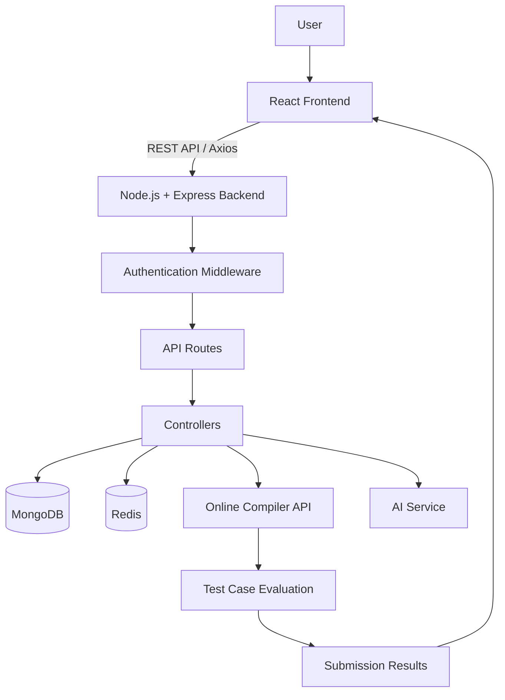
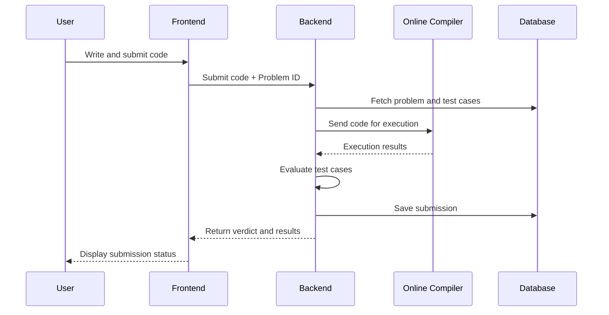

# 🚀 Coding Platform

### A Full-Stack Online Coding Platform

A full-stack coding platform where users can practice programming problems, write and execute code in multiple languages, submit solutions, and track their coding progress.

Built using the **MERN Stack**, with external online compiler integration and AI-powered doubt assistance.

<p align="center">
  
  
  
  
</p>

---

## ✨ Features

- **User Authentication** – Secure registration and login with protected routes.
- **Problem Management** – Create, manage, and explore programming problems.
- **Online Code Execution** – Execute code using an external compiler API.
- **Multiple Languages** – Support for C++, Java, and JavaScript.
- **Test Case Evaluation** – Validate submitted solutions against test cases.
- **Submission Tracking** – Store and review coding submissions.
- **AI Doubt Assistant** – Get assistance with programming-related doubts.
- **Editorial Support** – Access problem explanations and solutions.
- **Video Solutions** – Organize and access video-based problem explanations.
- **Admin Panel** – Manage problems and video content.

## 🏗️ System Architecture

The application follows a client-server architecture with a separate frontend and backend.



### Code Execution Workflow



## 🛠️ Tech Stack

| Category | Technologies |
|---|---|
| Frontend | React, Vite, Redux Toolkit |
| Styling | CSS |
| Backend | Node.js, Express.js |
| Database | MongoDB, Mongoose |
| Caching | Redis |
| Authentication | JWT, Middleware |
| HTTP Client | Axios |
| Code Execution | Online Compiler API |
| AI Integration | AI API |

## 📂 Project Structure

```text
Coding-Platform/
│
├── backend/
│   ├── src/
│   │   ├── config/
│   │   │   ├── db.js
│   │   │   └── redis.js
│   │   │
│   │   ├── controllers/
│   │   │   ├── solveDoubt.js
│   │   │   ├── userAuthent.js
│   │   │   ├── userProblem.js
│   │   │   ├── userSubmission.js
│   │   │   └── videoSection.js
│   │   │
│   │   ├── middleware/
│   │   │   ├── adminMiddleware.js
│   │   │   └── userMiddleware.js
│   │   │
│   │   ├── models/
│   │   │   ├── problem.js
│   │   │   ├── solutionVideo.js
│   │   │   ├── submission.js
│   │   │   └── user.js
│   │   │
│   │   ├── routes/
│   │   │   ├── aiChatting.js
│   │   │   ├── problemCreator.js
│   │   │   ├── submit.js
│   │   │   ├── userAuth.js
│   │   │   └── videoCreator.js
│   │   │
│   │   ├── utils/
│   │   │   ├── problemUtility.js
│   │   │   └── validator.js
│   │   │
│   │   └── index.js
│   │
│   ├── package.json
│   └── .gitignore
│
├── frontend/
│   ├── src/
│   │   ├── components/
│   │   ├── pages/
│   │   ├── assets/
│   │   ├── authSlice.js
│   │   ├── store/
│   │   ├── utils/
│   │   ├── App.jsx
│   │   └── main.jsx
│   │
│   ├── package.json
│   └── vite.config.js
│
└── README.md
```

## ⚙️ Installation and Setup

### 1. Clone the Repository

```bash
git clone https://github.com/Hrishikesh223/Coding-Platform.git
cd Coding-Platform
```

### 2. Backend Setup

```bash
cd backend
npm install
```

Create a `.env` file inside the backend directory.

Configure the required environment variables:

```env
PORT=3000
DB_CONNECT_STRING=your_mongodb_connection_string
REDIS_PASS=your_redis_password
JWT_SECRET=your_jwt_secret
```

Add any additional API credentials required by your backend integrations.

Start the backend:

```bash
npm run dev
```

### 3. Frontend Setup

Open another terminal:

```bash
cd frontend
npm install
npm run dev
```

The Vite development server will provide the local frontend URL.

## 🔌 Supported Programming Languages

| Language | Compiler Language ID |
|---|---:|
| C++ | 54 |
| Java | 62 |
| JavaScript | 63 |

*Execution is handled through the configured external compiler API.*

## 🔐 Security

- JWT-based authentication.
- Protected user and administrator routes.
- Environment variables for sensitive configuration.
- Git ignore rules to prevent committing secrets and dependencies.

## 🚧 Future Improvements

- Real-time code execution feedback.
- More programming language support.
- Leaderboards and coding rankings.
- User performance analytics.
- Timed coding contests.
- Enhanced problem recommendations.

## 👨‍💻 Author

**Hrishikesh Kumar Singh**

GitHub: [@Hrishikesh223](https://github.com/Hrishikesh223)

---

<p align="center">
  ⭐ If you find this project interesting, consider giving it a star!
</p>

<p align="center">
  Built with ❤️ and lots of code.
</p>
